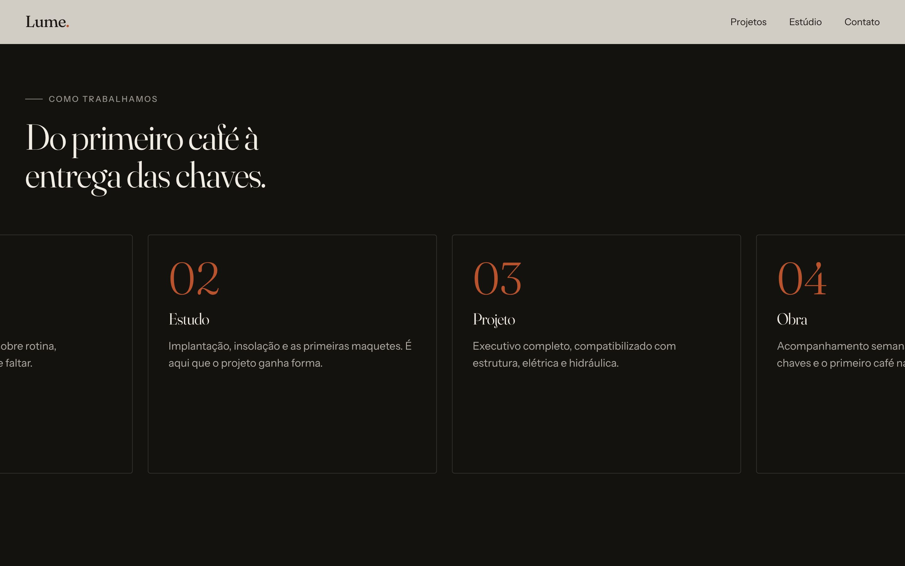
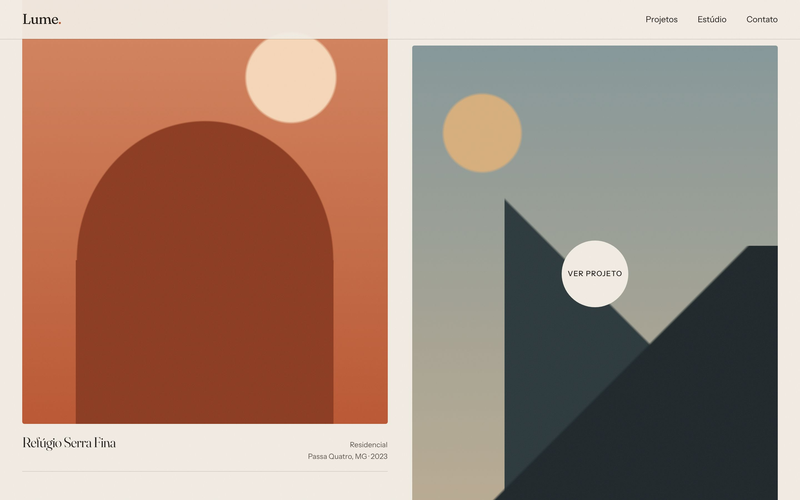

# Lume

Classic WordPress theme for a fictional architecture studio. The challenge I set for myself was building all visuals and animations **purely with HTML and CSS**, with no jQuery and zero front-end JavaScript. Styles are written in **SCSS** and compiled with **webpack**.


| Services marquees and manifesto | Process (horizontal scroll) |
| :---: | :---: |
|  |  |
| **Projects (hover)** | **Mobile** |
|  |  |

## What's included

- Custom post type **Projects**, with typology taxonomy and project specs (location, year, area, and status)
- Sectioned home page: hero, services marquee, manifesto with counters, projects, process, and contact
- Home copy, hero image, and contact details editable under **Appearance → Customize**
- Templates for single post, page, filterable projects archive, search, comments, and 404
- Projects without a featured image fall back to SVG illustrations in `assets/images/projetos` (chosen deterministically by ID so the card and cover always match)
- When no projects are published yet, the home page displays sample cards using those illustrations
- Block editor loads an `editor.css` matching the site's typography

## Animations (all in CSS)

| Effect | How it was built |
| :--- | :--- |
| Page transition: project card image morphs into the project cover | Cross-document View Transitions (`@view-transition { navigation: auto }`) with matching `view-transition-name` on card and cover |
| Opening curtain with the studio name | `::before` on the home `body` with two keyframes |
| Hero title entering word by word | `@keyframes` + `animation-delay` computed from a custom property (`--i`) injected by PHP on each word |
| Header gaining a background on scroll | `animation-timeline: scroll(root)` |
| Hero arches sinking / sun rising | parallax with `scroll()` |
| Manifesto lighting up as you read | `animation-timeline: view()` on each word |
| Counters (12, 140, 9) | `@property --num` of type `<integer>` animated and rendered with `counter()` |
| Project photos revealing like a curtain | `clip-path` + `view()` |
| Process section scrolling horizontally | tall section with `position: sticky` and `view-timeline-name` driving `translateX` |
| Light beam on the arch and glowing window | pseudo-elements with looping keyframes |
| Two services marquees moving in opposite directions (one outlined) | keyframes + `-webkit-text-stroke` |
| "View project" badge on card hover | `scale` and `rotate` transition |
| Reading progress bar and process section bar | `scaleX` bound to `scroll(root)` / the section's view timeline |
| Giant footer wordmark | `view()` animating position and `letter-spacing` |
| Mobile menu | checkbox + `clip-path: circle()` |
| Rotating badge in the contact section | looping keyframes |

Browsers without scroll-driven animation support (`@supports (animation-timeline: view())`) receive static content, and users with `prefers-reduced-motion` see no animations at all.

Bugs worth noting:

- `backdrop-filter` on the header constrained the mobile menu overlay (`position: fixed`) to the header's height because `backdrop-filter` establishes a containing block. Moving the background to a `::before` pseudo-element solved it.
- The header also has a `view-transition-name`. Morphing between the compact and regular versions caused duplicated text mid-transition, so it swaps directly without animating.
- The footer wordmark bleeds past the page edge, so it never reached 100% visibility and the animation stalled halfway. Ending the animation range at the midpoint of entry fixed it.

## Installation

1. Clone into `wp-content/themes`:
   ```bash
   git clone https://github.com/nathangrazo/lume-wordpress-theme.git wp-content/themes/lume
   ```
2. Activate the theme under **Appearance → Themes**
3. Under **Settings → Permalinks**, click Save (to flush rewrite rules for `/projetos/`)
4. Add projects and optionally assign a menu under **Appearance → Menus**

Requires WordPress 6.4+ and PHP 8.0+. Compiled CSS is already committed to the repository, so you do not need to run a build just to use the theme.

## Development

Styles live in `assets/scss` and are compiled by webpack (Sass → PostCSS/autoprefixer → extracted CSS) into `assets/dist/css`.

```bash
npm install
```

```bash
npm run dev
```

`dev` watches files and emits source maps. To generate minified CSS:

```bash
npm run build
```

Webpack handles CSS only. Since the entry point is an `.scss` file, webpack would emit an empty `.js` bundle; `webpack-remove-empty-scripts` removes it. `url()` references in SCSS bypass webpack (`css-loader` with `url: false`) because images live in `assets/images` and are served directly by WordPress.

### How SCSS is organized

- `abstracts/`: variables and mixins, outputting no CSS on their own. Main mixins:
  - `down()`/`up()`: media queries from a breakpoint map;
  - `scroll-driven`: wraps a block in `@supports (animation-timeline: view())`;
  - `timeline()`: one-line scroll-linked animation helper;
  - `word-reveal`: word-by-word heading reveal used in the hero and page headers.
- Each component keeps its own responsive rules and scroll-driven rules in the same file rather than a separate `responsive.css`.
- `@each` generates the three hero arches from a map (position, size, and delay) and the opening curtain delays. `@for` generates delays for the mobile menu items.

## Structure

```text
├── assets/
│   ├── scss/           # style source files
│   │   ├── abstracts/  # variables and mixins
│   │   ├── base/       # tokens, reset, typography, keyframes
│   │   ├── layout/     # header, menu, and footer
│   │   ├── components/ # button, project card, grid
│   │   ├── sections/   # home sections
│   │   ├── pages/      # inner pages, forms, 404
│   │   ├── effects/    # view transitions, curtain, grain, reduced motion
│   │   ├── main.scss
│   │   └── editor.scss # block editor styles
│   ├── dist/css/       # compiled CSS (generated by webpack)
│   └── images/         # favicon, texture, and project illustrations
├── inc/
│   ├── setup.php       # theme supports and menus
│   ├── enqueue.php     # fonts and CSS
│   ├── post-types.php  # projects, typology, and specs
│   ├── customizer.php  # home options
│   └── template-tags.php
├── template-parts/
│   ├── home/           # one template part per home section
│   └── content/        # project card and page header
└── *.php               # WordPress hierarchy templates
```

## License

GPL-2.0-or-later, just like WordPress itself.
