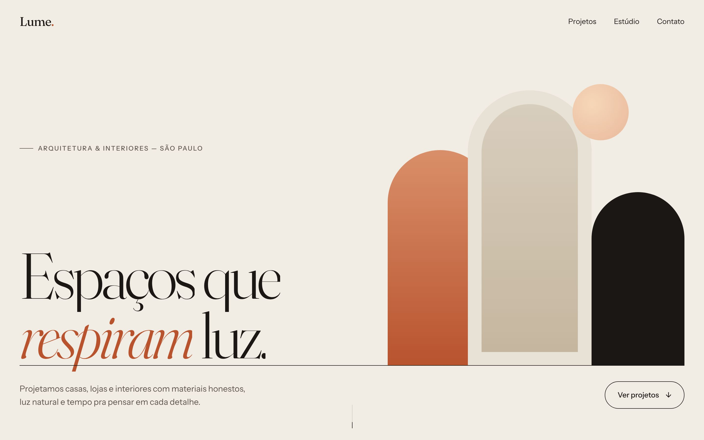

# Lume

Tema WordPress clássico para um estúdio de arquitetura fictício. O desafio que eu me dei foi fazer toda a parte visual e as animações **só com HTML e CSS**: sem jQuery, sem JavaScript próprio e sem etapa de build.



| Manifesto e números | Processo (scroll horizontal) | Mobile |
| :---: | :---: | :---: |
|  |  |  |

## O que tem

- Post type **Projetos**, com taxonomia de tipologia e ficha técnica (local, ano, área e status)
- Home montada em seções: hero, faixa de serviços, manifesto com números, projetos, processo e contato
- Textos da home, imagem do hero e contatos editáveis em **Aparência → Personalizar**
- Templates para post, página, arquivo de projetos com filtro, busca, comentários e 404
- Se ainda não houver projetos cadastrados, a home mostra cards de exemplo com ilustrações feitas em CSS

## Animações (todas em CSS)

| Efeito | Como foi feito |
| :--- | :--- |
| Título do hero entrando palavra por palavra | `@keyframes` + `animation-delay` calculado com uma custom property (`--i`) que o PHP coloca em cada palavra |
| Header que ganha fundo ao rolar | `animation-timeline: scroll(root)` |
| Arcos do hero afundando / sol subindo | parallax com `scroll()` |
| Manifesto que "acende" conforme a leitura | `animation-timeline: view()` em cada palavra |
| Contadores (12, 140, 9) | `@property --num` do tipo `<integer>` animado e exibido com `counter()` |
| Fotos dos projetos abrindo como cortina | `clip-path` + `view()` |
| Seção de processo andando na horizontal | seção alta com `position: sticky` e `view-timeline-name` controlando um `translateX` |
| Menu mobile | checkbox + `clip-path: circle()` |
| Faixa de serviços e selo giratório | keyframes em loop |

Navegadores sem suporte a scroll-driven animations (`@supports (animation-timeline: view())`) recebem o conteúdo estático, e quem usa `prefers-reduced-motion` não vê animação nenhuma.

Um bug que vale registrar: o `backdrop-filter` no header fazia o overlay do menu mobile (`position: fixed`) ficar do tamanho do header, porque `backdrop-filter` cria um containing block. A solução foi passar o fundo para um `::before`.

## Instalação

1. Clone dentro de `wp-content/themes`:
   ```bash
   git clone https://github.com/nathangrazo/rep1.git wp-content/themes/lume
   ```
2. Ative o tema em **Aparência → Temas**
3. Em **Configurações → Links permanentes**, clique em salvar (para registrar a URL `/projetos/`)
4. Cadastre projetos e, se quiser, defina um menu em **Aparência → Menus**

Requer WordPress 6.4+ e PHP 8.0+.

## Estrutura

```text
├── assets/css/         # base, layout, componentes, home, páginas, responsivo e animações
├── inc/
│   ├── setup.php       # theme supports e menus
│   ├── enqueue.php     # fontes e CSS
│   ├── post-types.php  # projetos, tipologia e ficha técnica
│   ├── customizer.php  # opções da home
│   └── template-tags.php
├── template-parts/
│   ├── home/           # uma parte por seção da home
│   └── content/        # card de projeto e cabeçalho de página
└── *.php               # templates da hierarquia do WordPress
```

## Licença

GPL-2.0-or-later, como o próprio WordPress.
