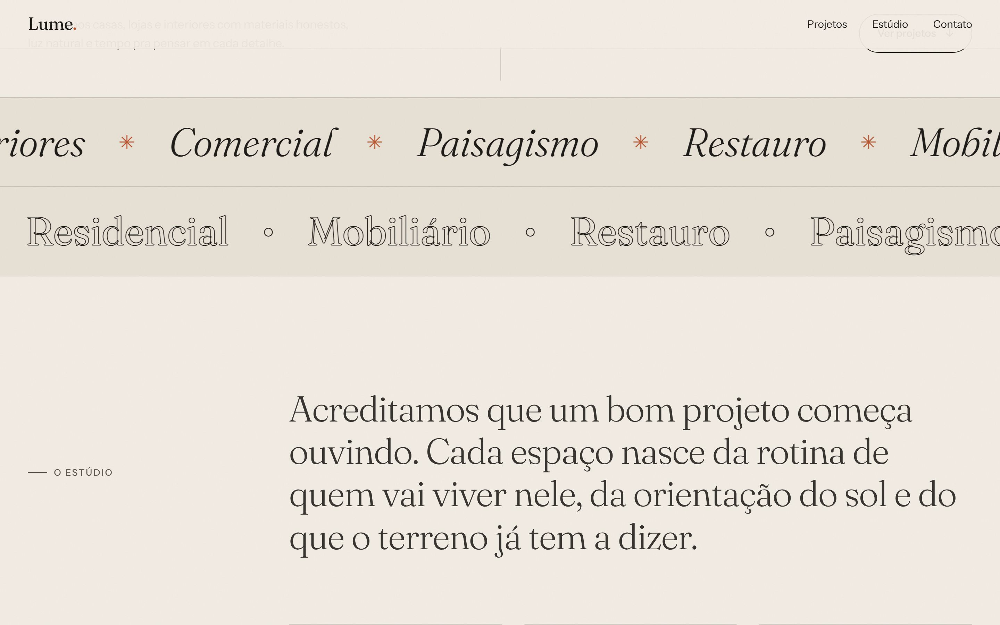
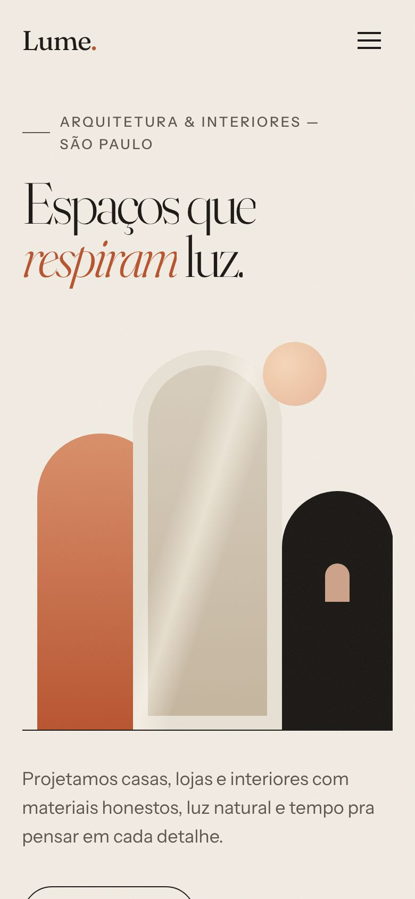

# Lume

Tema WordPress clássico para um estúdio de arquitetura fictício. O desafio que eu me dei foi fazer toda a parte visual e as animações **só com HTML e CSS**, sem jQuery e sem nenhum JavaScript no front. Os estilos são escritos em **SCSS** e compilados com **webpack**.


| Faixas de serviços e manifesto | Processo (scroll horizontal) |
| :---: | :---: |
|  |  |
| **Projetos (hover)** | **Mobile** |
|  |  |

## O que tem

- Post type **Projetos**, com taxonomia de tipologia e ficha técnica (local, ano, área e status)
- Home montada em seções: hero, faixa de serviços, manifesto com números, projetos, processo e contato
- Textos da home, imagem do hero e contatos editáveis em **Aparência → Personalizar**
- Templates para post, página, arquivo de projetos com filtro, busca, comentários e 404
- Projetos sem imagem destacada usam ilustrações SVG de `assets/images/projetos` (a escolha depende do ID, então o card e a capa mostram a mesma)
- Se ainda não houver projetos cadastrados, a home mostra cards de exemplo com essas ilustrações
- O editor de blocos carrega um `editor.css` com a mesma tipografia do site

## Animações (todas em CSS)

| Efeito | Como foi feito |
| :--- | :--- |
| Transição entre páginas: a imagem do card vira a capa do projeto | View Transitions entre documentos (`@view-transition { navigation: auto }`) e o mesmo `view-transition-name` no card e na capa |
| Cortina de abertura com o nome do estúdio | `::before` no `body` da home com dois keyframes |
| Título do hero entrando palavra por palavra | `@keyframes` + `animation-delay` calculado com uma custom property (`--i`) que o PHP coloca em cada palavra |
| Header que ganha fundo ao rolar | `animation-timeline: scroll(root)` |
| Arcos do hero afundando / sol subindo | parallax com `scroll()` |
| Manifesto que "acende" conforme a leitura | `animation-timeline: view()` em cada palavra |
| Contadores (12, 140, 9) | `@property --num` do tipo `<integer>` animado e exibido com `counter()` |
| Fotos dos projetos abrindo como cortina | `clip-path` + `view()` |
| Seção de processo andando na horizontal | seção alta com `position: sticky` e `view-timeline-name` controlando um `translateX` |
| Feixe de luz no arco e janela acendendo | pseudo-elementos com keyframes em loop |
| Duas faixas de serviços em sentidos opostos (uma vazada) | keyframes + `-webkit-text-stroke` |
| Selo "Ver projeto" no hover dos cards | `scale` e `rotate` com transição |
| Barra de progresso de leitura e da seção de processo | `scaleX` ligado a `scroll(root)` / à view timeline da seção |
| Wordmark gigante no rodapé | `view()` animando posição e `letter-spacing` |
| Menu mobile | checkbox + `clip-path: circle()` |
| Selo giratório no contato | keyframes em loop |

Navegadores sem suporte a scroll-driven animations (`@supports (animation-timeline: view())`) recebem o conteúdo estático, e quem usa `prefers-reduced-motion` não vê animação nenhuma.

Bugs que valeram a pena registrar:

- O `backdrop-filter` no header fazia o overlay do menu mobile (`position: fixed`) ficar do tamanho do header, porque `backdrop-filter` cria um containing block. A solução foi passar o fundo para um `::before`.
- O header também tem `view-transition-name`. Animar entre a versão compacta e a normal deixava o texto duplicado no meio da transição, então ele só troca, sem animar.
- O wordmark do rodapé "sangra" para fora da página, então nunca entrava 100% na tela e a animação parava no meio. O range passou a terminar na metade da entrada.

## Instalação

1. Clone dentro de `wp-content/themes`:
   ```bash
   git clone https://github.com/nathangrazo/lume-wordpress-theme.git wp-content/themes/lume
   ```
2. Ative o tema em **Aparência → Temas**
3. Em **Configurações → Links permanentes**, clique em salvar (para registrar a URL `/projetos/`)
4. Cadastre projetos e, se quiser, defina um menu em **Aparência → Menus**

Requer WordPress 6.4+ e PHP 8.0+. O CSS compilado já está no repositório, então não é preciso rodar o build para usar o tema.

## Desenvolvimento

Os estilos ficam em `assets/scss` e são compilados pelo webpack (Sass → PostCSS/autoprefixer → CSS extraído) em `assets/dist/css`.

```bash
npm install
```

```bash
npm run dev
```

O `dev` observa os arquivos e gera source maps. Para gerar o CSS minificado:

```bash
npm run build
```

O webpack só cuida do CSS. Como a entry é um `.scss`, ele geraria um `.js` vazio; o `webpack-remove-empty-scripts` apaga esse arquivo. Os `url()` do SCSS não passam pelo webpack (`css-loader` com `url: false`), porque as imagens ficam em `assets/images` e são servidas pelo próprio WordPress.

### Como o SCSS está organizado

- `abstracts/`: variáveis e mixins, sem gerar CSS. Os principais mixins:
  - `down()`/`up()`: media queries a partir de um map de breakpoints;
  - `scroll-driven`: envolve o bloco no `@supports (animation-timeline: view())`;
  - `timeline()`: animação ligada à rolagem em uma linha;
  - `word-reveal`: o efeito de título palavra por palavra, usado no hero e no cabeçalho das páginas.
- Cada componente tem o próprio responsivo e o próprio trecho scroll-driven no mesmo arquivo, em vez de um `responsive.css` separado.
- `@each` gera os três arcos do hero a partir de um map (posição, tamanho e atraso) e os atrasos da cortina de abertura. `@for` gera os atrasos dos itens do menu mobile.

## Estrutura

```text
├── assets/
│   ├── scss/           # código-fonte dos estilos
│   │   ├── abstracts/  # variáveis e mixins
│   │   ├── base/       # tokens, reset, tipografia, keyframes
│   │   ├── layout/     # header, menu e rodapé
│   │   ├── components/ # botão, card de projeto, grid
│   │   ├── sections/   # seções da home
│   │   ├── pages/      # páginas internas, formulários, 404
│   │   ├── effects/    # view transitions, cortina, granulado, reduced motion
│   │   ├── main.scss
│   │   └── editor.scss # estilos do editor de blocos
│   ├── dist/css/       # CSS compilado (gerado pelo webpack)
│   └── images/         # favicon, textura e ilustrações dos projetos
├── inc/
│   ├── setup.php       # theme supports e menus
│   ├── enqueue.php     # fontes e CSS
│   ├── post-types.php  # projetos, tipologia e ficha técnica
│   ├── customizer.php  # opções da home
│   └── template-tags.php
├── template-parts/
│   ├── home/           # uma parte por seção da home
│   └── content/        # card de projeto e cabeçalho de página
└── *.php               # templates da hierarquia do WordPress
```

## Licença

GPL-2.0-or-later, como o próprio WordPress.
